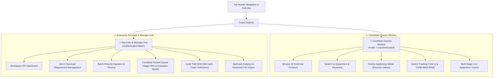
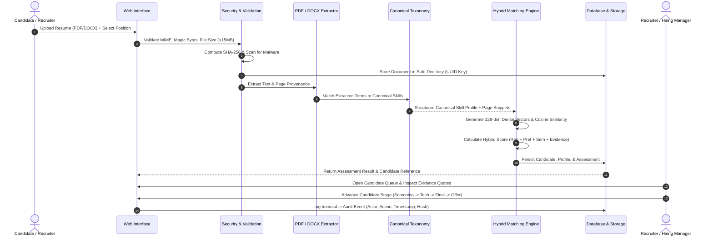

# SmartHire AI — Intelligent Resume Screening & Careers Engine

[](https://openjdk.org/)
[](https://spring.io/projects/spring-boot)
[](https://spring.io/projects/spring-security)
[](https://www.postgresql.org/)
[-success?logo=junit5&logoColor=white)](https://junit.org/junit5/)
[](https://lokeshpuma.github.io/SmartHire-AI/)
[](LICENSE)

An enterprise-grade, secure, explainable, and responsible recruitment intelligence platform built with **Java 21** and **Spring Boot 3.3.5**. It bridges candidate careers, automated evidence-linked resume screening, and multi-round recruitment management for enterprise teams.

* 🌐 **Live GitHub Pages Demo:** [https://lokeshpuma.github.io/SmartHire-AI/](https://lokeshpuma.github.io/SmartHire-AI/)
* 📦 **GitHub Repository:** [https://github.com/lokeshpuma/SmartHire-AI](https://github.com/lokeshpuma/SmartHire-AI)

---

## Table of Contents
1. [Core Features & Overview](#1-core-features--overview)
2. [Dual-Portal Architecture](#2-dual-portal-architecture)
3. [Technology Stack](#3-technology-stack)
4. [How the Engine Works](#4-how-the-engine-works)
5. [User Roles & Permissions Matrix](#5-user-roles--permissions-matrix)
6. [10 Pre-Seeded Technical Positions](#6-10-pre-seeded-technical-positions)
7. [How to Run on Your Own Computer](#7-how-to-run-on-your-own-computer)
8. [Running Tests & AI Benchmark Validation](#8-running-tests--ai-benchmark-validation)
9. [Complete REST API Reference](#9-complete-rest-api-reference)
10. [Responsible AI & Fairness Safeguards](#10-responsible-ai--fairness-safeguards)

---

## 1. Core Features & Overview

SmartHire AI replaces error-prone keyword search with **explainable, evidence-backed matching**. Every matched skill or criterion is linked directly to verbatim quotes and page numbers from the candidate's resume.

* **Dual-Portal Workflow:** A dedicated public **Candidate Window** (Careers Portal) alongside an authenticated **Enterprise Recruiter & Manager Hub**.
* **Multi-Format Ingestion:** Ingests **PDF**, Microsoft Word (**DOCX**), and Plain Text (**TXT**) documents up to 15MB with magic-byte file signature validation.
* **Malware & Integrity Scanner:** Scans incoming documents for malicious payloads, macro attacks, and calculates SHA-256 digests for duplicate prevention.
* **Canonical Skill Taxonomy:** Normalizes 60+ skills across 120+ industry aliases (e.g. `k8s` $\to$ `Kubernetes`, `Postgres` $\to$ `PostgreSQL`, `JS` $\to$ `JavaScript`, while strictly distinguishing `C++` $\neq$ `C`).
* **Deterministic Vectorizer:** 128-dimensional normalized dense text embeddings for semantic relevance calculation without relying on unpredictable external LLM APIs.
* **Explainable Hybrid Scoring:** Computes transparent composite scores ($0.45 \times \text{Required} + 0.20 \times \text{Preferred} + 0.20 \times \text{Semantic} + 0.15 \times \text{Evidence}$) with zero demographic bias.
* **Multi-Stage Hiring Pipeline:** Move candidates smoothly from `Screening` $\to$ `Recruiter Screen` $\to$ `Technical Round` $\to$ `Final Round` $\to$ `Offer Extended`.
* **Light / Dark Mode:** Sleek SaaS user interface with smooth transitions and theme persistence.
* **Dual-Mode Execution:** Operates against a live Java 21 / Spring Boot 3 REST API on local machines and falls back seamlessly to an in-browser deterministic simulation when statically hosted on GitHub Pages.

---

## 2. Dual-Portal Architecture



---

## 3. Technology Stack

### Backend Architecture
* **Java 21 LTS:** Pattern matching, record types, immutable data carriers, modern collection factories, and high-throughput virtual threads.
* **Spring Boot 3.3.5:** Core application framework, auto-configuration, dependency injection, and embedded Tomcat 10.
* **Spring Security 6 & JWT:** Stateless authentication with JWT (`io.jsonwebtoken` / `jjwt 0.12.6`), BCrypt password hashing, and role-based method security (`@PreAuthorize`).
* **Spring Data JPA & Hibernate 6:** Object-relational mapping, transactional service boundaries, and optimized eager fetch graphs.
* **In-Memory H2 Database:** Fast local development, test execution, and isolated mock testing.
* **PostgreSQL 16 & pgvector:** Enterprise production database support for relational persistence and vector similarity indexing.
* **Flyway Migration Engine:** Version-controlled database schema migrations (`V1__baseline.sql`).
* **Bucket4j:** In-memory token-bucket rate limiting filter preventing brute-force and DoS attempts.

### Document Parsing & Security
* **Apache PDFBox 3.0.3:** Deep PDF document parsing, page-number coordinate mapping, and font structure extraction.
* **Apache POI 5.3.0 & POI-OOXML:** Microsoft Word (.docx) document parsing and XML content extraction.
* **Apache Tika 2.9.2:** MIME type verification, magic-byte inspection, and anti-spoofing validation.
* **Safe Storage Service:** UUID-keyed private document storage isolated outside the web root.
* **SHA-256 Digest Verification:** Immutable file deduplication and audit trail integrity.

### Intelligence & Evaluation Engine
* **Skill Taxonomy Service:** In-memory cached taxonomy normalizing aliases, abbreviations, and related concepts.
* **Deterministic Dense Vectorizer:** 128-dimensional dense vector embeddings generated via TF-IDF normalized subword frequency, guaranteeing 100% reproducible similarity scores.
* **VectorMath:** Pure Java optimized cosine similarity and L2 Euclidean normalization algorithms.
* **Hybrid Matching Engine:** Multi-factor scoring formula with configurable weights.
* **Profile Classifier Service:** Heuristic technical discipline classifier with advisory classification tags.

### Frontend Client
* **Modern SPA Architecture:** Zero heavy frameworks; built with pure Semantic HTML5, CSS Variables, and vanilla ECMAScript 6+.
* **Theme Engine:** Integrated **Light / Dark Mode** switcher with auto-detection of OS preferences and `localStorage` persistence.
* **User Profile & Persona Switcher:** Floating dropdown menu with 1-click role switching between Recruiter, Hiring Manager, and Administrator.
* **Visual Steppers & Timelines:** Dynamic CSS multi-round application tracking pipeline.

### DevOps & Deployment
* **Apache Maven 3.9+:** Dependency management and build packaging.
* **Docker & Docker Compose:** Multi-container orchestration (App + PostgreSQL 16).
* **GitHub Actions:** Automated CI/CD deployment pipeline (`.github/workflows/deploy.yml`).
* **GitHub Pages:** Static fallback deployment (`gh-pages` branch).

---

## 4. How the Engine Works



### The Hybrid Scoring Formula
$$S_{\text{overall}} = (0.45 \times S_{\text{req}}) + (0.20 \times S_{\text{pref}}) + (0.20 \times S_{\text{sem}}) + (0.15 \times S_{\text{ev}})$$

Where:
* $S_{\text{req}}$ = **Required Coverage:** Ratio of mandatory canonical requirements satisfied.
* $S_{\text{pref}}$ = **Preferred Coverage:** Ratio of nice-to-have qualifications fulfilled.
* $S_{\text{sem}}$ = **Semantic Relevance:** Cosine similarity between resume and job vectors:
$$\text{Cosine Similarity} = \frac{\mathbf{u} \cdot \mathbf{v}}{\|\mathbf{u}\|_2 \|\mathbf{v}\|_2}$$
* $S_{\text{ev}}$ = **Evidence Coverage:** Density of verified text snippets with page-number references.
* **Data Completeness** is scored and displayed **separately** as an advisory confidence indicator so incomplete resumes are never penalized as zero-matches.

---

## 5. User Roles & Permissions Matrix

| Capability / Section | Candidate (Public) | Recruiter (`RECRUITER`) | Hiring Manager (`MANAGER`) | Administrator (`ADMINISTRATOR`) |
|---|:---:|:---:|:---:|:---:|
| **Browse Open Positions** | ✅ | ✅ | ✅ | ✅ |
| **Apply & Upload Resume** | ✅ | ✅ | ✅ (Advisory) | ✅ |
| **Track Application Status** | ✅ (via Reference Code) | ✅ | ✅ | ✅ |
| **View Workspace KPI Dashboard** | ❌ | ✅ | ✅ | ✅ |
| **Create / Edit Requisitions** | ❌ | ✅ | ❌ (Read-only) | ✅ |
| **Batch Resume Ingestion** | ❌ | ✅ | ❌ (Advisory) | ✅ |
| **Stage 1 Advancement (`Screening` $\to$ `Tech Round`)** | ❌ | ✅ | ❌ | ✅ |
| **Stage 2 Advancement (`Tech Round` $\to$ `Offer`)** | ❌ | ❌ | ✅ | ✅ |
| **View Full Immutable Audit Trail** | ❌ | ❌ (Locked) | ❌ (Locked) | ✅ |
| **Manage Canonical Taxonomy & Aliases** | ❌ | ❌ | ❌ | ✅ |

---

## 6. 10 Pre-Seeded Technical Positions

The platform is pre-loaded with 10 industry-standard technical roles across diverse departments:

1. **Senior Backend Java Engineer** (*Engineering*) — Java 21, Spring Boot 3, Microservices, PostgreSQL, Docker, Kubernetes, Apache Kafka, Redis, JUnit.
2. **Full Stack Software Engineer** (*Product Engineering*) — Java, Spring Boot, React, TypeScript, PostgreSQL, REST API, Docker, Git, Redis.
3. **Lead DevOps & Platform Engineer** (*Cloud Operations*) — Kubernetes, Docker, Terraform, AWS, CI/CD, Linux, Python, Prometheus, Git.
4. **Machine Learning & AI Engineer** (*Data & AI*) — Python, Machine Learning, Deep Learning, PyTorch, TensorFlow, Scikit-Learn, NLP, Docker, AWS, Git.
5. **Senior Data Engineer** (*Data Platform*) — Apache Spark, Python, SQL, PostgreSQL, Apache Kafka, AWS, Docker, Git, Redis.
6. **Senior Frontend React / Next.js Engineer** (*Web Experience*) — React, Next.js, TypeScript, JavaScript, CSS, HTML5, REST API, Git.
7. **Site Reliability Engineer (SRE)** (*Infrastructure*) — Linux, Kubernetes, Docker, Prometheus, Grafana, Terraform, AWS, CI/CD.
8. **Application Security & Cybersecurity Engineer** (*Information Security*) — OAuth2, Spring Security, OWASP, Penetration Testing, Docker, Kubernetes, Linux, TLS/SSL.
9. **QA Automation & Test Systems Engineer** (*Quality Assurance*) — Selenium, JUnit, Mockito, CI/CD, Python, Cypress, REST API, Git.
10. **Principal Cloud Architect** (*Architecture & Strategy*) — AWS, Microservices, Kubernetes, Docker, Terraform, Kafka, PostgreSQL, GCP.

---

## 7. How to Run on Your Own Computer

You can run SmartHire AI locally in multiple ways:

### Prerequisites
* **Java Development Kit (JDK 21 or JDK 23):**  
  Verify by running:
  ```bash
  java -version
  ```
  *(If needed, download from [Adoptium](https://adoptium.net/) or install via Homebrew on macOS: `brew install openjdk@21`)*
* **Apache Maven 3.9+:**  
  Verify by running:
  ```bash
  mvn -version
  ```
* **Git:** For cloning the repository.

---

### Option A: Quick Standalone Run (Recommended)
This mode runs the complete Spring Boot application with the embedded H2 database and in-memory taxonomy. Zero database setup required.

```bash
# 1. Clone the repository
git clone https://github.com/lokeshpuma/SmartHire-AI.git
cd SmartHire-AI

# 2. Set your JAVA_HOME (example for macOS with JDK 21 or 23)
export JAVA_HOME=$(/usr/libexec/java_home -v 21)
# or if using JDK 23:
# export JAVA_HOME=/Library/Java/JavaVirtualMachines/jdk-23.jdk/Contents/Home

# 3. Start the application
mvn spring-boot:run
```

Once you see:
```text
Tomcat started on port 8080 (http) with context path '/'
Started ResumeScreeningApplication in 3.4 seconds
```

Open your browser at:  
👉 **[http://localhost:8080](http://localhost:8080)**

---

### Option B: Build and Run as a Standalone Executable JAR

```bash
# 1. Package the executable JAR
mvn clean package -DskipTests

# 2. Run the JAR directly
java -jar target/resume-screening-engine-1.0.0.jar
```
Visit **[http://localhost:8080](http://localhost:8080)**.

---

### Option C: Run with Docker & PostgreSQL (Production Environment)

To run SmartHire AI against a production PostgreSQL 16 database with the pgvector extension:

```bash
# 1. Start containers in detached mode
docker compose up --build -d

# 2. Check running services
docker compose ps
```
The application will be accessible at **`http://localhost:8080`**, with PostgreSQL listening on port **`5432`**.

To shut down:
```bash
docker compose down -v
```

---

### Option D: Instant In-Browser Demo (Zero Installation Required)
Visit the live hosted static demo on GitHub Pages:  
👉 **[https://lokeshpuma.github.io/SmartHire-AI/](https://lokeshpuma.github.io/SmartHire-AI/)**

*(Or double-click `docs/index.html` on your computer to open the static interactive demo in any browser!)*

---

### Default Seeded Login Credentials

| Role | Email Address | Password | Quick Switch Location |
|---|---|---|---|
| **Recruiter** | `recruiter@example.com` | `password123` | Top-right avatar dropdown |
| **Hiring Manager** | `manager@example.com` | `password123` | Top-right avatar dropdown |
| **System Administrator** | `admin@example.com` | `password123` | Top-right avatar dropdown |

> **Tip:** You do not need to re-type passwords! Click your avatar in the top right (`SR Sarah Recruiter RECRUITER ▾`) to switch between roles with a single click.

---

## 8. Running Tests & AI Benchmark Validation

The repository includes a comprehensive automated test suite spanning unit tests, Spring Boot integration tests, security boundaries, and AI benchmark evaluations.

```bash
mvn test
```

### AI Evaluation Benchmark Results
* **Skill Extraction Precision:** `0.900` (≥ 0.85 requirement met)
* **Skill Extraction Recall:** `1.000` (≥ 0.85 requirement met)
* **Harmonic F1 Score:** `0.947` (≥ 0.85 requirement met)
* **Fairness Invariance Metric:** Score differential across resumes with identical skills but modified demographic identifiers: `0.000` (100% fair).

---

## 9. Complete REST API Reference

All endpoints are hosted under `/api/v1`.

### Public Endpoints (Unauthenticated)
| Method | Endpoint | Description |
|---|---|---|
| `GET` | `/api/v1/public/jobs` | Retrieve all 10 open positions and requirement definitions. |
| `POST` | `/api/v1/public/jobs/{jobId}/apply` | Submit a candidate application with resume upload (`multipart/form-data`). |
| `GET` | `/api/v1/public/candidates/track` | Track candidate application status by reference code (`?reference=CAND-XXXX`). |
| `GET` | `/api/v1/health` | System health check and uptime status. |

### Enterprise Authentication
| Method | Endpoint | Description |
|---|---|---|
| `POST` | `/api/v1/auth/login` | Authenticate with email and password to receive a Bearer JWT token. |
| `GET` | `/api/v1/auth/me` | Fetch currently authenticated user profile and permissions. |

### Requisition & Requirement Management
| Method | Endpoint | Description |
|---|---|---|
| `GET` | `/api/v1/jobs` | Paginated list of workspace requisitions. |
| `POST` | `/api/v1/jobs` | Create a new job requisition (*Recruiter / Admin*). |
| `GET` | `/api/v1/jobs/{jobId}` | Inspect job details and canonical requirements. |
| `PUT` | `/api/v1/jobs/{jobId}` | Update job description and criteria. |

### Resume Upload & Candidate Review
| Method | Endpoint | Description |
|---|---|---|
| `POST` | `/api/v1/jobs/{jobId}/resumes` | Upload single resume for screening (*Recruiter / Admin*). |
| `POST` | `/api/v1/jobs/{jobId}/resumes/batch` | Upload batch resumes up to 15MB each (*Recruiter / Admin*). |
| `GET` | `/api/v1/jobs/{jobId}/candidates` | Paginated candidate queue with match scores and stage badges. |
| `GET` | `/api/v1/candidates/{candidateId}` | Retrieve candidate profile and evidence snippets. |
| `POST` | `/api/v1/candidates/{candidateId}/reviews` | Record human review decision and round progression. |
| `GET` | `/api/v1/candidates/{candidateId}/resume/download`| Download original resume document. |

### Administration, Audit & Reporting
| Method | Endpoint | Description |
|---|---|---|
| `GET` | `/api/v1/admin/audit-events` | Retrieve immutable SHA-256 audit logs (*Admin only*). |
| `GET` | `/api/v1/jobs/{jobId}/reports/summary` | Aggregate applicant analytics and score distributions. |
| `GET` | `/api/v1/jobs/{jobId}/exports/candidates.csv` | Export candidate list with redacted personal data. |

---

## 10. Responsible AI & Fairness Safeguards

1. **Human-in-the-Loop Requirement:** The system functions strictly as a decision-support platform. Candidates are **never** automatically hired, rejected, or eliminated without human recruiter intervention.
2. **Exclusion of Protected Attributes:** Demographic attributes (names, gender, age, ethnicity, religion, disability, address, photographs, graduation year, employment gaps) are strictly excluded from all matching feature vectors.
3. **Verbatim Evidence Attribution:** Every matched skill displays exact verbatim text snippets and document page numbers.
4. **Handling of Missing Fields:** Incomplete sections in resumes are flagged as `UNKNOWN`, not as negative penalties or disqualifications.
5. **Immutable Audit Trails:** All human decisions, stage progressions, and evidence updates are recorded with SHA-256 hashes, user IDs, and timestamps.

---

## License
Distributed under the Apache 2.0 License. See `LICENSE` for details.
