# Intelligent Resume Screening Engine

An enterprise-grade, secure, and explainable recruitment decision-support platform built with **Java 21** and **Spring Boot 3.3.5**.

> **Important Responsible AI Safeguard:**  
> This application is an **advisory decision-support tool**, not an automated hiring decision-maker. It **never** automatically rejects, shortlists, or hires candidates without meaningful human review. All candidate rankings are transparent, fully explainable, and linked directly to source evidence in the resume. Irrelevant proxy features and protected demographic characteristics are strictly excluded from candidate scoring.

---

## 1. System Architecture

```mermaid
flowchart TD
    subgraph UI ["Recruiter Web Interface"]
        WebUI["Modern Web Application (SPA)<br/>Dashboard / Jobs / Review Queue"]
    end

    subgraph API ["Spring Boot REST APIs (/api/v1)"]
        AuthCtrl["Auth & RBAC Controller"]
        JobCtrl["Job Description Controller"]
        ResumeCtrl["Resume Upload & Ingestion"]
        MatchCtrl["Hybrid Matching Controller"]
        ReviewCtrl["Human Review & Decision Controller"]
        ReportCtrl["Reporting & CSV Export"]
        AdminCtrl["Audit & Settings Controller"]
    end

    subgraph Core ["Core Intelligence Engine (Java 21)"]
        DocParser["Document Extractor<br/>(Apache PDFBox, POI, Tika)"]
        TaxonomySvc["Skill Taxonomy Service<br/>(Canonicalization & Aliases)"]
        ProfileExt["Profile & Evidence Extractor<br/>(Evidence Linking with Page Numbers)"]
        Classifier["Advisory Profile Classifier"]
        EmbeddingSvc["Deterministic Dense Vectorizer<br/>(128-dim Normalized L2 Embeddings)"]
        MatchingEngine["Explainable Matching Engine<br/>Score = (w_req * Cov_req) + (w_pref * Cov_pref) + (w_sem * Sem) + (w_ev * Ev)"]
    end

    subgraph Storage ["Persistence & Storage"]
        H2Postgres[("Relational DB<br/>PostgreSQL / H2")]
        PrivateDisk["Private Document Store<br/>(UUID storage keys, outside web root)"]
        AuditLog[("Immutable Audit Trail")]
    end

    WebUI --> API
    API --> Core
    Core --> Storage
```



---

## 2. Core Functional Highlights

| Capability | Implementation Details | PRD Reference |
|---|---|---|
| **Multi-Format Ingestion** | Validates PDF, DOCX, and TXT using file signatures (magic bytes) and MIME detection. Checks file size (15MB) and page limits (25 pages). SHA-256 duplicate detection. | Section 4.3 |
| **Malware Scanning** | Pluggable `MalwareScanner` verifying signatures and blocking active macro/executable content. | Section 4.3 |
| **Evidence Extraction** | Extracts structured skills, work history, education, and certifications. Every skill is linked to source evidence with page numbers and text snippets. | Section 4.5 |
| **Skill Taxonomy** | Rich canonical taxonomy with aliases (`JS` → `JavaScript`, `Postgres` → `PostgreSQL`, `k8s` → `Kubernetes`, while strictly distinguishing `C++` != `C`). | Section 4.6 |
| **Advisory Classification** | Categorizes candidates into technical disciplines (Software Engineering, Data Engineering, DevOps, Quality, ML/AI) with advisory tags. | Section 4.7 |
| **Explainable Matching** | Hybrid scoring combining structured required coverage (45%), preferred coverage (20%), semantic relevance (20%), and evidence coverage (15%). | Section 4.8 |
| **Completeness Separation** | Data completeness and confidence are scored and displayed **separately** from match score. | Section 4.8 |
| **Human Review Workflow** | Recruiters can review candidates, correct extracted evidence with change tracking, record decisions, and add notes. | Section 4.10 |
| **Workspace Isolation** | Multi-tenant workspace isolation enforced in every database query and service layer. | Section 4.1 |
| **Audit & Retention** | Sensitive actions logged to immutable audit trail with sanitized metadata. Supports complete data deletion per retention policies. | Section 4.1 & 6.3 |
| **Reports & Export** | Job-level applicant pool analytics, score distributions, and authorized CSV export with redacted personal data. | Section 4.11 |

---

## 3. Responsible AI & Fairness Safeguards

1. **No Automated Decisions:** The engine never issues an automatic hire, shortlist, or rejection decision. All outcomes require an authorized human recruiter's sign-off.
2. **Exclusion of Protected Attributes:** Demographic attributes (names, gender, age, ethnicity, religion, disability, address, graduation year, employment gaps, photographs) are strictly excluded from scoring features.
3. **Evidence-Backed Explanations:** Every matched requirement displays the candidate's exact resume quote and page number.
4. **Handling of Missing Information:** Missing fields are recorded as `UNKNOWN`, not as proof of absence or negative penalty.
5. **Audited Evidence Corrections:** When a recruiter updates or corrects an extracted skill, prior values and reviewer identity are immutably logged.

---

## 4. Default Credentials (Seeded)

The database automatically seeds a sample workspace (**Acme Tech Workspace**) and three default role accounts:

| Role | Email | Password | Permissions |
|---|---|---|---|
| **Recruiter** | `recruiter@example.com` | `password123` | Create/edit jobs, upload resumes, review profiles, record decisions, export CSV |
| **Hiring Manager** | `manager@example.com` | `password123` | View shared candidates, inspect evidence, record structured feedback |
| **Administrator** | `admin@example.com` | `admin123` | Manage users, configure workspace retention policies, view audit trail |

---

## 5. Quick Start

### Prerequisites
- **Java 21+** (Java 21 or Java 23)
- **Maven 3.9+**
- (Optional) **Docker & Docker Compose**

### Running Locally (Standalone Mode)
```bash
# 1. Set JAVA_HOME (if not already set)
export JAVA_HOME=/Library/Java/JavaVirtualMachines/jdk-23.jdk/Contents/Home

# 2. Run the application
mvn spring-boot:run
```
Open **[http://localhost:8080](http://localhost:8080)** in your browser to access the complete interactive Web UI.

### Running with Docker Compose (PostgreSQL with pgvector)
```bash
docker compose up --build
```
This starts PostgreSQL 16 with pgvector on port `5432` and the Spring Boot application on port `8080`.

---

## 6. Running Tests & AI Evaluation

Execute the complete test suite including unit tests, integration tests, security tests, and AI evaluation benchmarks:

```bash
mvn test
```

### AI Evaluation Benchmark Results
The benchmark dataset evaluates canonical skill extraction precision, recall, and F1:
- **Precision:** `0.900` (≥ 0.85 requirement met)
- **Recall:** `1.000` (≥ 0.85 requirement met)
- **F1 Score:** `0.947` (≥ 0.85 requirement met)
- **Fairness Invariance:** Score differential across demographic variants with identical qualifications: `0.000` (100% fair).

---

## 7. REST API Reference (`/api/v1`)

### Authentication
- `POST /api/v1/auth/login` — Sign in and obtain JWT token.
- `POST /api/v1/auth/logout` — Invalidate session and audit log sign out.
- `GET /api/v1/auth/me` — Return current authenticated user profile.

### Jobs & Requirements
- `POST /api/v1/jobs` — Create a new job description.
- `GET /api/v1/jobs` — List jobs (paginated).
- `GET /api/v1/jobs/{jobId}` — Get job details.
- `PUT /api/v1/jobs/{jobId}` — Update job details.
- `POST /api/v1/jobs/{jobId}/requirements/parse` — Automatically parse requirements from JD text for recruiter review.
- `PUT /api/v1/jobs/{jobId}/requirements` — Save edited requirements and weights.

### Resumes & Candidates
- `POST /api/v1/jobs/{jobId}/resumes` — Upload single resume (`multipart/form-data`).
- `POST /api/v1/jobs/{jobId}/resumes/batch` — Upload batch resumes.
- `GET /api/v1/jobs/{jobId}/candidates` — Get ranked review queue for job.
- `GET /api/v1/candidates/{candidateId}` — Get candidate profile and extracted details.
- `GET /api/v1/candidates/{candidateId}/evidence` — Get extracted evidence items.
- `DELETE /api/v1/candidates/{candidateId}/resume` — Delete resume and derived data (retention policy).
- `GET /api/v1/candidates/{candidateId}/resume/download` — Download original resume file.

### Matching & Review
- `POST /api/v1/jobs/{jobId}/assessments` — Trigger hybrid matching assessment.
- `GET /api/v1/jobs/{jobId}/assessments` — List job assessments.
- `GET /api/v1/candidates/{candidateId}/assessments/{jobId}` — Get criterion-level match breakdown.
- `POST /api/v1/candidates/{candidateId}/reviews` — Record human decision and notes.
- `PUT /api/v1/candidates/{candidateId}/evidence/{evidenceId}` — Correct extracted evidence.

### Reporting & Admin
- `GET /api/v1/jobs/{jobId}/reports/summary` — Aggregated applicant analytics and score distribution.
- `GET /api/v1/jobs/{jobId}/exports/candidates.csv` — CSV export of screened candidate pool.
- `GET /api/v1/admin/audit-events` — View workspace audit trail (Administrator only).
- `GET /api/v1/admin/skills` — View taxonomy skills.
- `POST /api/v1/admin/skills` — Register custom canonical skills and aliases.
- `GET /api/v1/admin/workspaces` — View workspace retention settings.
- `GET /api/v1/health` — System health and responsible AI status check.
